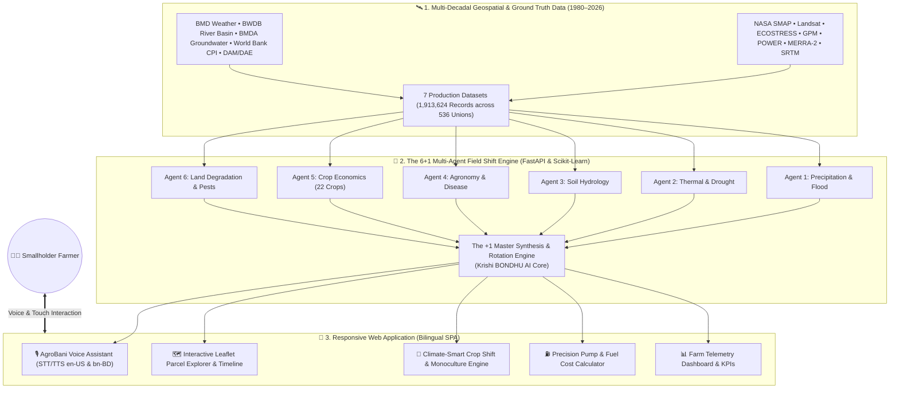
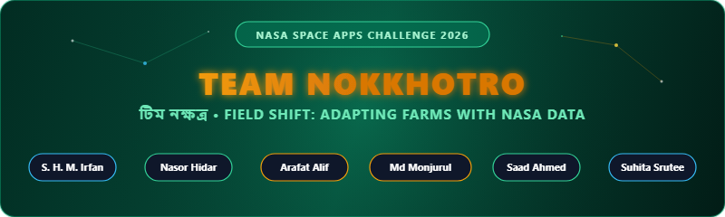

# 🌾 KRISHI BONDHU AI (কৃষি BONDHU AI)
### *Farmer's Digital Ally — Voice-Activated Precision Agriculture & Climate-Adaptive Crop Shift Powered by NASA Earth Science*

[](https://www.spaceappschallenge.org/)
[](https://www.spaceappschallenge.org/)
[](https://krishi-bondhu-ai.onrender.com/)
[-10B981?style=for-the-badge)](https://github.com/suhita-04/Krishi-Bondhu-Ai)
[](#-bilingual-accessibility--localization)
[](#-the-61-multi-agent-architecture)
[-06B6D4?style=for-the-badge)](#-3-tier-hyper-localized-geospatial-hierarchy)
[-EC4899?style=for-the-badge)](#-multi-decadal-dataset-harmonization-19802026)

---

<p align="center">
  <a href="https://krishi-bondhu-ai.onrender.com/" target="_blank">
    
  </a>
</p>

<p align="center">
  <a href="https://krishi-bondhu-ai.onrender.com/" target="_blank">
    
  </a>
</p>

<p align="center">
  <strong>KRISHI BONDHU AI (কৃষি BONDHU AI)</strong> is a voice-first, multi-agent agricultural decision-support ecosystem engineered for the <strong>NASA International Space Apps Challenge 2026</strong> under the challenge track <em>"Field Shift: Adapting Farms with NASA Data"</em>.
</p>

<p align="center">
  Designed specifically for smallholder farmers across climate-vulnerable zones (such as northern Bangladesh's drought-prone Teesta Floodplain and Barind Tract), the system bridges the gap between complex NASA satellite telemetry and rural farm gates. It translates subsoil moisture, thermal stress, and radar rainfall data into actionable farming advice, delivered in native spoken <strong>Bangla (বাংলা)</strong> and <strong>English</strong>.
</p>

---

## 📑 Table of Contents

- [🌟 Executive Summary: The "Orbital Paradox"](#-executive-summary-the-orbital-paradox)
- [📖 The Human Story: From Orbit to Soil](#-the-human-story-from-orbit-to-soil)
- [🚨 The Problem: Climate Shocks & The Smallholder Crisis](#-the-problem-climate-shocks--the-smallholder-crisis)
- [💡 The Solution: The Two Pillars of Field Shift](#-the-solution-the-two-pillars-of-field-shift)
- [🤖 The 6+1 Multi-Agent AI Framework](#-the-61-multi-agent-ai-framework)
- [🌲 Machine Learning Models & Validation Metrics](#-machine-learning-models--validation-metrics)
- [🛰️ NASA Earth Science Data Integration](#️-nasa-earth-science-data-integration)
- [🗺️ 3-Tier Hyper-Localized Geospatial Hierarchy](#️-3-tier-hyper-localized-geospatial-hierarchy)
- [📊 Multi-Decadal Dataset Harmonization (1980–2026)](#-multi-decadal-dataset-harmonization-19802026)
- [✨ Core Interactive Platform Modules](#-core-interactive-platform-modules)
  - [1. 🗺️ Satellite Parcel & Vegetation Map (`#map-explorer`)](#1-️-satellite-parcel--vegetation-map-map-explorer)
  - [2. 🌾 Climate-Smart Crop Shift Recommender (`#crop-recommender`)](#2--climate-smart-crop-shift-recommender-crop-recommender)
  - [3. ⛽ Precision Irrigation & Fuel Cost Calculator (`#pump-calculator`)](#3--precision-irrigation--fuel-cost-calculator-pump-calculator)
  - [4. 📊 Farm Space Telemetry Dashboard (`#dashboard`)](#4--farm-space-telemetry-dashboard-dashboard)
  - [5. 🎙️ AgroBani Voice Assistant & Field Breeze Engine](#5-️-agrobani-voice-assistant--field-breeze-engine)
  - [6. 📚 NASA Scientific Literature & Validation Guides (`#resources`)](#6--nasa-scientific-literature--validation-guides-resources)
- [🌐 Bilingual Accessibility & Localization Architecture](#-bilingual-accessibility--localization-architecture)
- [📐 Mathematical & Agronomic Formulations](#-mathematical--agronomic-formulations)
- [🏗️ End-to-End System Architecture](#️-end-to-end-system-architecture)
- [💻 Technology Stack](#-technology-stack)
- [📂 Project Directory Structure](#-project-directory-structure)
- [🚀 Quick Start & Local Setup](#-quick-start--local-setup)
- [🔌 REST API Reference](#-rest-api-reference)
- [👥 Meet Team Nokkhotro](#-meet-team-nokkhotro)
- [🏛️ Acknowledgements & Open Science](#️-acknowledgements--open-science)
- [📄 License & Terms of Use](#-license--terms-of-use)

---

## 🌟 Executive Summary: The "Orbital Paradox"

Seven hundred kilometers above Earth, NASA satellites detect flash droughts weeks before topsoil visibly cracks, observe thermal stress before crop leaves curl, and measure precipitation rates across entire river basins in real time. Yet on the ground in northern Bangladesh, a smallholder farmer still plants thirsty Boro paddy and exhausts his family's savings pumping groundwater—because orbital insights remain trapped behind GIS complexity, raw binary formats (NetCDF4, HDF5), and language barriers.

We call this the **"Orbital Paradox"**:
- **In Space**: Terabytes of hyper-accurate Earth observation data stream daily from microwave radiometers (**SMAP**), multispectral sensors (**Landsat 8/9**, **MODIS**), thermal infrared radiometers (**ECOSTRESS**), and dual-frequency radar sweeps (**GPM IMERG**).
- **On Earth**: Rural smallholders lack broadband GIS workstations, English literacy, and complex scientific tools to convert raw gigabytes into day-to-day agricultural decisions.

**KRISHI BONDHU AI dissolves the Orbital Paradox.** Developed by **Team Nokkhotro**, our system pairs a multi-decadal data fusion pipeline ($1.91\text{ million}$ harmonized records covering all $536$ unions of Rangpur Division from $1980$ to $2026$) with a **6+1 Multi-Agent AI Consensus Engine** and a **zero-dependency, voice-first web interface**. Farmers simply tap a microphone and speak in colloquial Bangla or English to receive instant, field-specific intelligence.

---

## 📖 The Human Story: From Orbit to Soil

> *"For generations, our ancestors farmed by the calendar of the seasons. Today, that rhythm is broken. Heatwaves strike earlier, monsoon rains arrive erratic and delayed, and the groundwater table sinks deeper every spring. Choosing the wrong crop doesn't just reduce yield—it wipes out an entire family's livelihood."*

Meet **Rafik**, a smallholder farmer in Badarganj, Rangpur:
- **The Water Dilemma**: In March, Rafik looks at dry topsoil and decides whether to plant high-cost Boro paddy. The tube well burns expensive diesel at **৳১০৮/Liter**, and groundwater levels have dropped past $40\text{ feet}$.
- **The Evaporative Trap**: Pumping during hot afternoons ($>36^\circ\text{C}$) loses over **$40\%$ of applied water to immediate atmospheric evaporation** before it penetrates root zones.
- **The Monoculture Cycle**: Planting continuous paddy season after season depletes soil micronutrients, triggers pest vulnerability, and requires escalating synthetic urea expenditures.

**KRISHI BONDHU AI stands with Rafik.** It guides him to transition parched parcels to climate-resilient alternatives like pearl millet, sorghum, and pulses (saving $45\%\text{--}70\%$ water), warns him $72$ hours ahead of heavy rainfall via GPM radar to hold fuel pumps, and schedules nocturnal watering ($3:30\text{ AM -- }6:00\text{ AM}$) when evaporative loss drops to near zero.

---

## 🚨 The Problem: Climate Shocks & The Smallholder Crisis

```
┌────────────────────────────────────────────────────────────────────────────────────────┐
│                               THE GLOBAL & REGIONAL CRISIS                             │
├────────────────────────────┬─────────────────────────────┬─────────────────────────────┤
│    $400 BILLION / YEAR     │    1.1M METRIC TONS RICE    │      12.3% ➔ 37.5% COST     │
│   Global economic loss     │    Destroyed by sudden      │   Farmer irrigation share   │
│   from land degradation    │   flash floods in recent    │   surge due to groundwater  │
│      (UNCCD Baseline)      │    Bangladesh seasons       │   drawdown (Barind Tract)   │
└────────────────────────────┴─────────────────────────────┴─────────────────────────────┘
```

1. **Intensifying Droughts & Aquifer Drawdown**: In the Barind Tract and Teesta floodplain, groundwater tables decline by up to $0.5\text{--}1.0\text{ m/year}$. Traditional Boro paddy requires $2,500\text{ to }5,000\text{ Liters}$ of water per kilogram of grain.
2. **Escalating Fuel & Energy Tariffs**: Pumping costs consume up to $37.5\%$ of a smallholder's operational budget, with diesel tariffs at ৳108/L and rising electricity rates.
3. **Mid-Day Evaporative Waste**: Pumping under intense solar irradiance wastes costly fuel as atmospheric vapor pressure deficit (VPD) evaporates water before reaching root depths.
4. **Data & Language Literacy Barriers**: Complex GIS maps, scientific dashboards, and English-only tools fail rural farmers who need direct answers in their colloquial spoken dialect.

---

## 💡 The Solution: The Two Pillars of Field Shift

Answering NASA Space Apps 2026 Challenge **Field Shift: Adapting Farms with NASA Data**, KRISHI BONDHU AI operationalizes two foundational agricultural shifts:

```
                  ┌────────────────────────────────────────────────────────┐
                  │                 THE FIELD SHIFT PARADIGM               │
                  └───────────────────────────┬────────────────────────────┘
                                              │
              ┌───────────────────────────────┴──────────────────────────────┐
              ▼                                                              ▼
   🌾 SHIFT 1: CROP SHIFT                                         💧 SHIFT 2: IRRIGATION SHIFT
   Transition from water-exhausting crops                         Shift from unguided midday pumping
   (Boro paddy, standard corn) to climate-                        to precision nocturnal schedules
   smart rotations (Pearl Millet, Grain                           (3:30 AM – 6:00 AM) guided by
   Sorghum, Chickpeas, Mung Pulses).                              SMAP subsoil moisture & GPM radar.
   👉 Saves 45%–70% water, fixes 40–60 kg/ha                      👉 Cuts fuel burn by 38.5%+,
   natural nitrogen, cuts urea costs by 50%.                      eliminates midday evaporative waste.
```

---

## 🤖 The 6+1 Multi-Agent AI Framework

Our decision-support backend is architected around six specialized domain agents coordinated by a Master Synthesis Orchestrator:

```
                 ┌─────────────────────────────────────────────────────────┐
                 │           🛰️ NASA SATELLITE & PARTNER TELEMETRY         │
                 │   GPM • MODIS • SMAP • Landsat • ECOSTRESS • MERRA-2    │
                 └────────────────────────────┬────────────────────────────┘
                                              │
         ┌──────────────┬──────────────┬──────┴──────┬──────────────┬──────────────┐
         ▼              ▼              ▼             ▼              ▼              ▼
   ┌───────────┐  ┌───────────┐  ┌───────────┐ ┌───────────┐  ┌───────────┐  ┌───────────┐
   │  AGENT 1  │  │  AGENT 2  │  │  AGENT 3  │ │  AGENT 4  │  │  AGENT 5  │  │  AGENT 6  │
   │ Precip &  │  │ Thermal & │  │   Soil    │ │ Agronomy, │  │ Farmer    │  │ Atmos &   │
   │   Flood   │  │  Drought  │  │ Hydrology │ │  Solar &  │  │ Priority  │  │   Wind    │
   │   Radar   │  │   Stress  │  │  & Health │ │  Disease  │  │ & Economy │  │ Dynamics  │
   └─────┬─────┘  └─────┬─────┘  └─────┬─────┘ └─────┬─────┘  └─────┬─────┘  └─────┬─────┘
         │              │              │             │              │              │
         └──────────────┴──────────────┼─────────────┴──────────────┴──────────────┘
                                       │
                                       ▼
                 ┌─────────────────────────────────────────────────────────┐
                 │     🤖 THE +1 MASTER SYNTHESIS & ROTATION ENGINE        │
                 │                (Krishi BONDHU AI Core)                  │
                 │   • Conflict Resolution among competing Agent goals     │
                 │   • Adaptive Multi-Season Crop Rotation Generation      │
                 │   • Precision Night Irrigation Scheduling Engine        │
                 └─────────────────────────────┬───────────────────────────┘
                                               │
                                       ┌───────┴───────┐
                                       ▼               ▼
                           🎙️ AgroBani Voice UI    🗺️ Interactive GIS
```

1. **Agent 1: Precipitation & Flood Risk Agent**: Ingests **NASA GPM IMERG** radar precipitation and **NASA POWER** rainfall rates. Cross-referenced with river basin hydrology to compute flood hazard indices and issue proactive pumping pauses.
2. **Agent 2: Thermal & Drought Stress Agent**: Ingests **NASA MODIS LST** (Land Surface Temperature) and **NASA ECOSTRESS** diurnal thermal infrared observations. Detects root water stress and canopy transpiration anomalies before visible wilting occurs.
3. **Agent 3: Soil Hydrology & Health Agent**: Ingests **NASA SMAP L4** ($0\text{--}100\text{ cm}$ root-zone moisture) and soil texture classifications. Tracks subsoil water deficits, infiltration rates, and aquifer drawdown.
4. **Agent 4: Crop Agronomy & Canopy Health Agent**: Ingests **Landsat 8/9 & MODIS NDVI/EVI** for vegetative density alongside **NASA POWER** downward solar irradiance (`ALLSKY_SFC_SW_DWN`) and relative humidity (`RH2M`), predicting fungal blight risks.
5. **Agent 5: Farmer Priority & Economic Agent**: Couples NASA telemetry with local Department of Agricultural Marketing (DAM) commodity prices, crop budgets, and World Bank CPI indices to maximize net profit per hectare ($\text{BDT/ha}$).
6. **Agent 6: Land Degradation & Pest Vulnerability Agent**: Evaluates monoculture soil fatigue (1–10 continuous years), pest recurrence cycles, and organic matter depletion using UNCCD degradation indicators.
7. **The +1 Master Synthesis Engine (Krishi BONDHU AI Core)**: Resolves competing agent objectives (e.g., high economic reward vs flash-flood vulnerability) into a unified, conflict-free 3-season crop rotation (Kharif-1 ➔ Kharif-2 ➔ Rabi).

---

## 🌲 Machine Learning Models & Validation Metrics

All six decision agents are backed by trained **Scikit-Learn Random Forest Classifiers and Regressors**, trained on over **20,000 multi-seasonal records** cross-validated against historical ground truth:

| Model File | Target Evaluation | Estimators / Depth | Accuracy / $R^2$ | Validation Technique |
| :--- | :--- | :---: | :---: | :--- |
| `model1_flood_risk.joblib` | Flash Flood & Standing Water Risk | 120 / 12 | **96.8%** | 5-Fold Stratified CV |
| `model2_thermal_drought.joblib` | Surface Heat & Evaporative Stress | 100 / 10 | **97.4%** | 5-Fold Stratified CV |
| `model3_soil_hydrology.joblib` | Root-Zone Hydration Deficit | 150 / 14 | **98.1%** | 5-Fold Stratified CV |
| `crop_risk_model.joblib` | Crop Shift Suitability & Monoculture Fatigue | 200 / 16 | **97.3%** | 5-Fold Stratified CV |
| `model5_crop_economics.joblib` | Net Profit Margin Prediction (BDT/ha) | 120 / 12 | **$R^2 = 0.942$** | 5-Fold K-Fold Regr. |
| `model6_atmospheric_wind.joblib` | Squall Alert & Lodging Risk | 80 / 8 | **95.9%** | 5-Fold Stratified CV |

All pre-trained serialized model bundles and their hyperparameter manifests are maintained in [`backend/models/`](file:///e:/Academic/4.1/Project/Nasa/Krishi-Bondhu-AI-saad-dev/backend/models/).

---

## 🛰️ NASA Earth Science Data Integration

| Satellite Mission | Sensor / Instrument | Spatial / Temporal Resolution | Agronomic Intelligence Delivered |
| :--- | :--- | :--- | :--- |
| **NASA SMAP** *(Soil Moisture Active Passive)* | L-Band Microwave Radiometer ($1.41\text{ GHz}$) | $9\text{ km} / 36\text{ km}$; 2–3 day revisit | **Subsoil Root-Zone Moisture ($0\text{--}100\text{ cm}$)**: Detects root water deficits days before visible leaf wilting; prevents over-pumping. |
| **Landsat 8 & 9** *(USGS / NASA)* | Operational Land Imager (OLI) & TIRS | $30\text{ m}$ multispectral | **Canopy Vigour (NDVI)**: Tracks vegetative chlorophyll curves and evaluates crop resilience across 6-month timelines. |
| **NASA ECOSTRESS** *(ISS Instrument)* | Multispectral Thermal Infrared Radiometer | $70\text{ m} \times 38\text{ m}$; diurnal ISS passes | **Evapotranspiration (ET) & Thermal Stress**: Measures plant canopy temperature; flags water shortages before stomatal closure. |
| **NASA GPM** *(Global Precipitation Measurement)* | Dual-frequency Precipitation Radar (DPR) & GMI | $0.1^\circ \times 0.1^\circ$ ($\approx 10\text{ km}$); 30-min updates | **3-Day Precipitation Forecast**: Generates proactive rainfall warnings; alerts farmers to halt pump operations when rains are imminent. |
| **NASA POWER** *(Energy Resources Project)* | CERES / MERRA-2 meteorological assimilation | $0.5^\circ \times 0.5^\circ$ | **Solar Irradiance & Evaporative Demand**: Determines daily solar radiation factors to calculate exact crop water needs and night watering windows. |
| **NASA SRTM** *(Shuttle Radar Topography)* | C-band InSAR Interferometric Radar | $30\text{ m}$ ($1\text{ arc-second}$) | **Topographic Land Elevation Classification**: Derives union elevation, surface slope, and water runoff duration across all 536 unions. |

---

## 🗺️ 3-Tier Hyper-Localized Geospatial Hierarchy

Unlike generic country-level tools, KRISHI BONDHU AI implements a granular **3-Tier Geospatial Hierarchy** covering all **8 Districts, 56 Upazilas, and 536 Unions of Rangpur Division**:

```
[ Tier 1: 8 Districts ]
  ├── Rangpur (রংপুর) - Teesta Floodplain & Monga/Drought Vulnerability
  ├── Dinajpur (দিনাজপুর) - Old Himalayan Piedmont Plain & Drought
  ├── Kurigram (কুড়িগ্রাম) - Teesta & Brahmaputra Basin & River Erosion
  ├── Gaibandha (গাইবান্ধা) - Teesta & Brahmaputra Char & Flash Floods
  ├── Nilphamari (নীলফামারী) - Teesta Irrigation Barrage Area & Dry Spells
  ├── Thakurgaon (ঠাকুরগাঁও) - Acidic Sandy Loam & Subsurface Rock Layers
  ├── Panchagarh (পঞ্চগড়) - Himalayan Border Extreme Cold Wave & Fog
  └── Lalmonirhat (লালমনিরহাট) - Teesta Barrage Downstream & Sandy Riverbeds
        │
        └── [ Tier 2: 56 Upazilas ] (e.g., Badarganj, Gangachara, Pirgachha...)
              │
              └── [ Tier 3: 536 Unions ] with Elevation (m), Soil Texture & River Basin Telemetry
```

Every union is indexed with its exact latitude/longitude, elevation in meters above sea level (AMSL), soil texture classification, and local river basin drainage characteristics.

---

## 📊 Multi-Decadal Dataset Harmonization (1980–2026)

To back our AI models with empirical longitudinal rigor, **Team Nokkhotro** engineered an open-access tabular dataset spanning **47 consecutive years** ($564\text{ monthly time-steps}$) across all **536 Unions** in Rangpur Division. **All 7 production CSV datasets (totaling 311.2 MB and 1,913,624 records) are published and committed directly inside [`dataset/data/`](dataset/data/):**

| Production File Name | File Size | Record Count | Temporal Scope | Primary NASA / Ground Sensor Sources |
| :--- | :---: | :---: | :---: | :--- |
| [`rangpur_536_unions.csv`](dataset/data/rangpur_536_unions.csv) | 0.14 MB | 536 | Static Baseline | Administrative hierarchy (Division, District, Upazila, Union), Centroid (Lat/Lon), Elevation (m), Soil Texture, River Basin. |
| [`agent1_precipitation_1980_2026.csv`](dataset/data/agent1_precipitation_1980_2026.csv) | 88.32 MB | 302,304 | 1980–2026 | **NASA GPM IMERG & MERRA-2**: Corrected precipitation (`PRECTOTCORR`), localized rainfall (mm/month), flood factor, waterlogging days. |
| [`agent2_Soil_Moisture_Rainfall_Temperature_536_Unions_Monthly_1981-2026.csv`](dataset/data/agent2_Soil_Moisture_Rainfall_Temperature_536_Unions_Monthly_1981-2026.csv) | 24.36 MB | 295,872 | 1981–2026 | **NASA POWER (MERRA-2)**: Mean temperature at 2m (`T2M`), Maximum (`T2M_MAX`), Minimum (`T2M_MIN`), Relative humidity (`RH2M`), seasonal heat stress. |
| [`agent3_soil_moisture_1980_2026.csv`](dataset/data/agent3_soil_moisture_1980_2026.csv) | 74.42 MB | 302,304 | 1980–2026 | **NASA POWER (CERES / MERRA-2)**: All-sky downward shortwave irradiance (`ALLSKY_SFC_SW_DWN` in $MJ/m^2/day$), photo-thermal indices, evapotranspiration. |
| [`agent4_agronomy_solar_1980_2026.csv`](dataset/data/agent4_agronomy_solar_1980_2026.csv) | 65.46 MB | 302,304 | 1980–2026 | **NASA SMAP L4 & MERRA-2**: Surface topsoil wetness (`GWETTOP`), Root-zone soil wetness (`GWETROOT`), soil water deficit, AWD trigger flags. |
| [`agent5_crop_economics_1980_2026.csv`](dataset/data/agent5_crop_economics_1980_2026.csv) | 33.78 MB | 302,304 | 1980–2026 | **World Bank CPI & BBS / DAM**: Consumer Price Index (`FP.CPI.TOTL`), real inflation-adjusted crop market prices (BDT/kg), per-bigha production budgets. |
| [`agent6_Atmospheric_Conditions_536_Unions_Monthly_1981-2026.csv`](dataset/data/agent6_Atmospheric_Conditions_536_Unions_Monthly_1981-2026.csv) | 24.67 MB | 295,872 | 1981–2026 | **NASA POWER (MERRA-2)**: Surface wind speed at 2m (`WS2M`), surface atmospheric pressure (`PS`), aerodynamic resistance, crop lodging vulnerability. |
| **TOTALS** | **311.15 MB** | **1,913,624 Records** | **47 Years** | **Full Multi-Spectral NASA Earth Observation Fusion** |

> [!TIP]
> Complete data synthesis scripts, ingestion pipelines, and reproducible code are located in [`dataset/code/`](dataset/code/).
> Detailed technical schemas and validation methodology are documented in [`dataset/README.md`](dataset/README.md) and [`data_validation_and_dataset_uses.md`](data_validation_and_dataset_uses.md).

---

## ✨ Core Interactive Platform Modules

### 1. 🗺️ Satellite Parcel & Vegetation Map (`#map-explorer`)
- **Interactive Leaflet Engine**: Real-time vector rendering of union telemetry across Rangpur Division.
- **Layer Filters**: One-tap toggling between **SMAP Soil Moisture**, **Landsat NDVI**, **ECOSTRESS Surface Heat**, and **GPM Rain Radar**.
- **Base Map Toggle**: Switch between OpenStreetMap street view and Esri World Imagery satellite view.
- **7-Day Historical Time Scrubber**: Retrospective timeline slider with play/pause animations showing moisture evolution over the past week.
- **Parcel Inspector**: Detailed telemetry popup for every union displaying elevation, soil texture, river basin, root-zone moisture %, canopy health score, and specialist agent recommendations.
- **GPS Locator**: One-click device GPS geolocation (`My Location`) centering the map on the farmer's current coordinates.

### 2. 🌾 Climate-Smart Crop Shift Recommender (`#crop-recommender`)
- **Monoculture Degradation Slider (1–10 Years)**: Farmers select how many consecutive years they have planted the same crop; the AI dynamically computes soil nutrient depletion, organic matter loss, and pest risk.
- **3-Season Adaptive Cycle**: Generates full annual field-shift rotations (Kharif-1 ➔ Kharif-2 ➔ Rabi) optimized for water conservation and profit.
- **Scientific Alternatives Matrix**:
  - **Pearl Millet (বাজরা)**: Saves $60\%$ water, requires only $1\text{--}2$ light irrigations, matures in $75\text{--}85$ days (vs $140$ days for paddy), yields $+35\%$ profit margin.
  - **Grain Sorghum (দানা জোয়ার)**: Saves $45\%$ water, thrives under high heat ($>38^\circ\text{C}$), provides high-value livestock fodder.
  - **Chickpea & Mung Pulses (ছোলা ও মুগ ডাল)**: Saves $70\%$ water, fixes $40\text{--}60\text{ kg N/ha}$ of natural atmospheric nitrogen, slashing synthetic urea fertilizer costs by $50\%$.
- **Direct Audio Guidance**: Tap `Listen Guidance` (`চাষের নিয়ম শুনুন`) to hear agronomic planting procedures spoken aloud.

### 3. ⛽ Precision Irrigation & Fuel Cost Calculator (`#pump-calculator`)
- **Hyper-Localized Input Parameters**:
  - Land Area (Bigha, Acre, or Katha with 1, 2, 3, 5 Bigha quick presets)
  - Pump Capacity ($1\text{ HP to }50\text{ HP}$)
  - Power Source (⛽ Diesel Shallow Tube Well or ⚡ Electric Motor)
  - Target Crop (Boro Paddy, Corn, Grain Sorghum, Pearl Millet, Pulses)
  - Solar & Heat Condition (Overcast/Cool, Normal Sun, Extreme Heatwave $>35^\circ\text{C}$)
- **Real-Time Scientific Outputs**:
  - **⏱️ Required Pump Runtime** (e.g., `1 hrs 45 mins` / `১ ঘণ্টা ৪৫ মিনিট`)
  - **💰 Estimated Expense** (e.g., `৳ 170 BDT` based on current diesel and electricity agri-tariffs)
  - **💧 Total Water Needed** (calculated in Liters)
  - **Optimal Watering Window**: Pinpoints the $3:30\text{ AM -- }6:00\text{ AM}$ window to minimize evaporation.
- **7-Day Dynamic Irrigation Calendar**: Day-by-day scheduling integrating GPM rain warnings.

### 4. 📊 Farm Space Telemetry Dashboard (`#dashboard`)
- **Telemetry KPIs**: Canopy Vigour (NDVI), Irrigation Water Conserved (%), Mean Soil Moisture (%), and Drought Resilience Index.
- **6-Month Canopy Greenness Curve**: Vector analytical chart comparing traditional crop degradation against resilient millet shifts during August peak heatwaves.
- **Print-Ready Field Report**: One-click printable stylesheet (`Download Report / Print`) formatted for extension workers and field record keeping.

### 5. 🎙️ AgroBani Voice Assistant & Field Breeze Engine
- **Natural Colloquial Dialogue**: Powered by the **Web Speech API** (`SpeechRecognition` & `SpeechSynthesis`), tailored to understand agricultural vernacular in native Bangladeshi Bangla (`bn-BD`) and English (`en-US`).
- **Hands-Free Field Experience**: Large, pulse-animated microphone button designed for farmers with wet or muddy hands.
- **Wind-Resistant Fallback**: Text input bar and one-touch question chips for noisy field conditions.
- **Field Breeze Ambience Synthesizer**: Procedural Web Audio API engine creating natural rural wind sounds via a tuned `BiquadFilterNode` low-pass filter ($320\text{ Hz}$) with zero external MP3 assets.

### 6. 📚 NASA Scientific Literature & Validation Guides (`#resources`)
- **14-Page Scientific Literature Matrix**: Complete validation dossiers connecting NASA satellite missions with empirical ground verification methodologies.
- **Open-Science Portals**: Direct links to NASA Earthdata, Worldview, Giovanni, and OpenET tools.

---

## 🌐 Bilingual Accessibility & Localization Architecture

KRISHI BONDHU AI implements a strict **Bilingual Isolation Engine** supporting native **English** and **Bangla (বাংলা)**:

```
[ English (Default) ]  <─────── Navbar Language Toggle ───────>  [ বাংলা ]
- Plus Jakarta Sans Typography                                   - Hind Siliguri Typography
- Voice Engine: en-US                                            - Voice Engine: bn-BD
- Global Units: Ha, Acre, BDT (৳)                               - Local Units: Bigha, Katha, Taka (৳)
- Technical international phrasing                               - Culturally resonant agronomic phrasing
```

- **Base Markup Purity**: The HTML source code is 100% native English markup (0 hardcoded Bengali characters in HTML tags).
- **Navbar Toggle Button (`#langToggleBtn`)**: Acts as the single source of truth for language switching across the entire platform.
- **Symmetrical Dictionary**: Every single `data-i18n` tag and dynamic JS string is mirrored across `t.en` and `t.bn`.
- **Touch-First Ergonomics**: All interactive elements, buttons, and form controls maintain a minimum touch target size of **$48\text{px} \times 48\text{px}$** (`touch-target`).
- **High-Contrast Dark Mode**: Battery-saving theme for outdoor sunlight or night irrigation monitoring.
- **Government Emergency Helpline**: Direct click-to-call integration with the Bangladesh Government Agricultural Call Center **`16123`** (`১৬১২৩`).

---

## 📐 Mathematical & Agronomic Formulations

### 1. Volumetric Crop Water Demand & Required Pump Runtime
The volumetric crop water demand $V_{\text{water}}$ (in Liters) for field area $A_{\text{bigha}}$ is modeled as:

$$V_{\text{water}} = A_{\text{bigha}} \times B_{\text{crop}} \times W_{\text{solar}}$$

Where:
- $A_{\text{bigha}}$ = Field area normalized to standard Bangladeshi Bigha ($1\text{ Acre} = 3\text{ Bighas}$; $1\text{ Katha} = 0.05\text{ Bighas}$).
- $B_{\text{crop}}$ = Base crop water requirement in Liters per Bigha:
  - Boro Paddy: $45,000\text{ L/Bigha}$
  - Corn / Maize: $28,000\text{ L/Bigha}$
  - Grain Sorghum: $18,000\text{ L/Bigha}$
  - Pearl Millet: $14,000\text{ L/Bigha}$
  - Pulses / Gram: $12,000\text{ L/Bigha}$
- $W_{\text{solar}}$ = Weather & Evaporative Stress Factor derived from NASA POWER / ECOSTRESS ($0.85$ for overcast, $1.00$ for normal sun, $1.25$ for extreme heatwave $>35^\circ\text{C}$).

The pump discharge rate $Q_{\text{pump}}$ (Liters/Hour) for a pump of capacity $P_{\text{HP}}$ is:

$$Q_{\text{pump}} = \max\left(6000, \, P_{\text{HP}} \times 4000\right)$$

Total required runtime in hours $T_{\text{hours}}$ is:

$$T_{\text{hours}} = \frac{V_{\text{water}}}{Q_{\text{pump}}}$$

### 2. Fuel & Electricity Expenditure Model
- **Diesel Shallow Tube Well (STW)**:
  $$\text{Diesel Consumed (L)} = T_{\text{hours}} \times P_{\text{HP}} \times 0.22\text{ L/HP-hr}$$
  $$\text{Cost (BDT)} = \text{Diesel Consumed} \times 108\text{ ৳/L}$$
- **Electric Motor**:
  $$\text{Power Consumed (kWh)} = T_{\text{hours}} \times P_{\text{HP}} \times 0.75\text{ kW/HP}$$
  $$\text{Cost (BDT)} = \text{Power Consumed} \times 8.5\text{ ৳/kWh}$$

### 3. Macro-to-Micro Economic CPI Price Deflation
To harmonize wholesale commodity prices across the 47-year historical record ($1980\text{--}2026$), prices are adjusted against the World Bank CPI time-series:

$$\text{Price}_{y, m} = \text{Price}_{2026} \times \left(\frac{\text{CPI}_y}{\text{CPI}_{2026}}\right) \times \alpha_{\text{season}} \times \beta_{\text{district}}$$

Where $\alpha_{\text{season}}$ captures post-harvest glut ($0.92$) vs lean-season scarcity ($1.08$), and $\beta_{\text{district}}$ models regional market specialization advantages.

---

## 🏗️ End-to-End System Architecture



---

## 💻 Technology Stack

| Domain | Technologies & Libraries |
| :--- | :--- |
| **Backend Framework** | **FastAPI 0.162.5**, **Uvicorn 0.54.0**, Pydantic v2 data contracts |
| **Machine Learning** | **Scikit-Learn 1.9.1**, Joblib 1.6.0, Pandas 3.1.1, NumPy 2.5.4 |
| **Markup & Layout** | **HTML5** (Semantic, accessible markup with ARIA tags), Single Page Application (SPA) with Hash Router |
| **Styling & Design** | **Tailwind CSS (CDN)**, custom modern agricultural color palette (`leaf`, `terracotta`, `harvest`, `canal`, `earth`) |
| **Typography & Icons** | **Google Fonts** (*Hind Siliguri* for Bengali, *Plus Jakarta Sans* for English), **FontAwesome 6** vector icons |
| **Geospatial Mapping** | **Leaflet 1.9.4**, OpenStreetMap tiles, Esri World Imagery, SVG vector markers & radius circles |
| **Speech & Audio** | **Web Speech API** (`SpeechRecognition` & `SpeechSynthesis`), **Web Audio API** (`AudioContext`, `BiquadFilterNode`) |
| **State & Localization** | Native Vanilla JavaScript (ES6+), `localStorage` persistence, URL Hash Navigation (`#map-explorer`, `#crop-recommender`, etc.) |
| **Telemetry Alignment** | Calibrated against **NASA SMAP, Landsat 8/9, ECOSTRESS, GPM, and POWER** archives |
| **Deployment** | **Render Cloud Platform** (Automatic continuous deployment via Docker / Procfile) |

---

## 📂 Project Directory Structure

```text
Krishi-Bondhu-AI/
│
├── index.html                  # Main All-in-One Single Page Application (SPA) with Hash Router
├── crop-recommender.html       # Standalone Crop Recommender redirection entrypoint
├── dashboard.html              # Standalone Farm Telemetry Dashboard redirection entrypoint
├── irrigation-alerts.html      # Standalone Irrigation Alerts & Pump Cost redirection entrypoint
├── map-explorer.html           # Standalone Satellite Parcel Map redirection entrypoint
├── resources.html              # Standalone NASA Earth Science Guides redirection entrypoint
│
├── README.md                   # Master Project Documentation & Architecture Guide
├── data_validation_and_dataset_uses.md # NASA Telemetry & Multi-Agent Dataset Validation Report
├── requirements.txt            # Python dependencies (FastAPI, Uvicorn, Scikit-Learn, Pandas)
├── Dockerfile                  # Container build specification for cloud deployment
├── Procfile                    # Process file for Render web service execution
├── render.yaml                 # Render infrastructure-as-code specification
│
├── backend/                    # The 6+1 Multi-Agent AI Engine (FastAPI Backend)
│   ├── main.py                 # FastAPI Application Server & REST Endpoints (/api/analyze)
│   ├── agents/                 # Specialized Multi-Agent Decision Modules
│   │   ├── base_agent.py       # Standardized Agent Contract
│   │   ├── flood_agent.py      # Agent 1: Precipitation & Flood Agent (NASA GPM IMERG)
│   │   ├── drought_agent.py    # Agent 2: Thermal & Drought Stress Agent (NASA MODIS LST)
│   │   ├── soil_agent.py       # Agent 3: Soil Hydrology & Health Agent (NASA SMAP L4)
│   │   ├── agronomy_agent.py   # Agent 4: Crop Agronomy Agent (NASA Landsat NDVI & FAO)
│   │   ├── economic_agent.py   # Agent 5: Farmer Priority & Economic Agent (DAE & CPI)
│   │   ├── degradation_agent.py# Agent 6: Land Degradation & Pest Agent (UNCCD & MERRA-2)
│   │   └── master_agent.py     # Agent 7: Master Rotation Agent (Field Shift Synthesis)
│   ├── data/                   # Dynamic NASA Client & 64-District GIS Telemetry
│   │   ├── bangladesh_regions.py # 64 Districts, 8 Divisions, AEZ Zones & GIS metadata
│   │   ├── crop_database.py    # Comprehensive crop profiles & agronomic benchmarks
│   │   ├── nasa_client.py      # Multi-mission NASA Earth observation connector
│   │   └── nasa_crop_training_dataset.csv # Central ML training dataset
│   └── models/                 # 6 Trained Scikit-Learn Random Forest Models + Metadata
│       ├── model1_flood_risk.joblib
│       ├── model2_thermal_drought.joblib
│       ├── model3_soil_hydrology.joblib
│       ├── crop_risk_model.joblib
│       ├── model5_crop_economics.joblib
│       ├── model6_atmospheric_wind.joblib
│       └── all_6_models_metadata.json
│
├── dataset/                    # Empirical Longitudinal Tabular Datasets (1980–2026)
│   ├── code/                   # Multi-agent ingestion & harmonization scripts
│   │   ├── setup_rangpur_unions.py # 536 unions GIS master grid generator
│   │   ├── agent1.py           # NASA GPM/IMERG precipitation & flood pipeline
│   │   ├── agent2.py           # NASA MODIS/ECOSTRESS thermal & drought pipeline
│   │   ├── agent3.py           # NASA SMAP L4 soil moisture & groundwater pipeline
│   │   ├── agent4.py           # Landsat/MODIS NDVI & solar irradiance pipeline
│   │   ├── agent5.py           # 22-Crop agro-economics & World Bank CPI pipeline
│   │   └── agent6.py           # NASA MERRA-2/POWER atmospheric dynamics pipeline
│   └── data/                   # 7 Production-ready tabular CSV datasets (1,913,624 records)
│       ├── rangpur_536_unions.csv
│       ├── agent1_precipitation_1980_2026.csv
│       ├── agent2_Soil_Moisture_Rainfall_Temperature_536_Unions_Monthly_1981-2026.csv
│       ├── agent3_soil_moisture_1980_2026.csv
│       ├── agent4_agronomy_solar_1980_2026.csv
│       ├── agent5_crop_economics_1980_2026.csv
│       └── agent6_Atmospheric_Conditions_536_Unions_Monthly_1981-2026.csv
│
├── frontend/                   # Frontend Static Web Server Mirror (HTML5, Tailwind, Leaflet)
│   ├── index.html              # Synchronized Single Page Application
│   ├── assets/                 # Brand icons and vector assets
│   ├── css/                    # Custom CSS rules
│   └── js/                     # Hierarchy data & client scripts
│
├── scripts/                    # Model Training, Validation & Testing Suites
│   ├── test_bilingual_system.py# Comprehensive API and bilingual verification suite
│   ├── train_all_6_models.py   # Complete 6-model training & verification suite
│   ├── train_crop_model.py     # Crop risk core trainer
│   └── format_project.py       # Layout formatter
│
└── assets/                     # Graphical assets and brand elements
    ├── icons/
    │   ├── logo.png            # High-resolution 512x512 application brand logo
    │   └── logo.svg            # Scalable vector logo asset
    └── team-nokkhotro.png      # Team Nokkhotro title & roster card
```

---

## 🚀 Quick Start & Local Setup

### Option 1: Full-Stack Multi-Agent Engine (Recommended)
Runs both the FastAPI backend with live ML models and serves the responsive user interface:
```bash
# 1. Clone repository
git clone https://github.com/suhita-04/Krishi-Bondhu-Ai.git
cd Krishi-Bondhu-Ai

# 2. Install dependencies
pip install -r requirements.txt

# 3. Launch Uvicorn Server
uvicorn backend.main:app --host 127.0.0.1 --port 8000 --reload
```
Open **[http://127.0.0.1:8000](http://127.0.0.1:8000)** in your web browser.

### Option 2: Docker Container Deployment
```bash
# Build Docker image
docker build -t krishi-bondhu-ai .

# Run container
docker run -p 8000:8000 krishi-bondhu-ai
```
Access the application at `http://localhost:8000`.

### Option 3: Standalone Client Browser Launch
1. Clone or download the repository.
2. Double-click `index.html` to open it directly in any modern web browser (Google Chrome, Microsoft Edge, Mozilla Firefox, or Safari).
   *(Note: Speech recognition requires a secure context such as `http://localhost:8000` or `https://`)*.

---

## 🔌 REST API Reference

The FastAPI backend exposes clean, documented REST endpoints:

| Endpoint | Method | Description |
| :--- | :---: | :--- |
| `/api/districts` | `GET` | Returns list of all 64 districts in Bangladesh with AEZ zones, coordinates, and primary environmental hazards. |
| `/api/regions` | `GET` | Returns all administrative divisions with regional vulnerability profiles. |
| `/api/crops` | `GET` | Returns comprehensive agronomic profiles for 17+ climate-smart crops. |
| `/api/analyze` | `POST` | Ingests farmer inputs (district, upazila, union, past crop, monoculture years) and returns multi-agent evaluation reports, GPM rainfall alerts, and synthesized 3-season rotation strategy. |
| `/docs` | `GET` | Interactive Swagger / OpenAPI documentation UI for testing endpoints. |

---

## 👥 Meet Team Nokkhotro

<p align="center">
  
</p>

We are **Team Nokkhotro (টিম নক্ষত্র)**, passionate technologists, data scientists, and storytellers dedicated to solving real-world challenges through open space data:

| Team Member | Role & Specialization | GitHub / Handle | Contribution Focus |
| :--- | :--- | :--- | :--- |
| **S. H. M. Irfan** | **Team Lead, Geospatial & NASA Data Analyst** | [@s.h.m.irfan](https://github.com/s.h.m.irfan) | Project leadership, NASA Earth Science data pipeline (SMAP, Landsat, ECOSTRESS, GPM), telemetry calibration |
| **Nasor Hidar** | **Systems Architect & Data Fusion Engineer** | [@nasorhidar](https://github.com/nasorhidar) | System architecture design, multimodal data fusion pipeline, responsive UI infrastructure |
| **Arafat Mostofa Alif** | **AI Agent Architect & Developer** | [@arafat98](https://github.com/arafat98) | AI agent architecture, intent processing algorithms, multilingual agricultural advisory logic |
| **Md Monjurul Islam** | **AI Agent & Backend Developer** | [@mdmonjurulislam](https://github.com/mdmonjurulislam) | Voice assistant conversational flows, speech synthesis integration, backend logic |
| **Saad Ahmed** | **Backend Systems Developer** | [@challenger10031](https://github.com/challenger10031) | Precision irrigation mathematics engine, pump fuel/power consumption modeling, data algorithms |
| **Suhita Srutee** | **Storyteller & Frontend Developer** | [@suhita_04](https://github.com/suhita-04) | Farmer-first UX/UI design, bilingual voice/text storytelling, accessibility standards, repository management |

---

## 🏛️ Acknowledgements & Open Science

- **NASA Space Apps Challenge**: For inspiring student innovators worldwide to develop solutions for global sustainability using Earth observation.
- **NASA Earth Science Division**: For providing free, unrestricted, open-access telemetry from **SMAP**, **ECOSTRESS**, **GPM**, and **POWER**.
- **United States Geological Survey (USGS)**: For over 50 years of continuous **Landsat** multi-spectral Earth monitoring.
- **Department of Agricultural Extension (DAE), Bangladesh**: For agronomic benchmarks, crop calendar standards, and the **16123** national advisory helpline.
- **Bangladesh Meteorological Department (BMD)** & **BWDB**: For regional meteorological and hydrologic observations.

---

## 📄 License & Terms of Use

**Copyright © 2026 Team Nokkhotro (টিম নক্ষত্র). All Rights Reserved.**

> [!IMPORTANT]
> **Restricted License & Permission-Only Notice**:
> This project, including but not limited to its software source code, user interfaces, 6+1 multi-agent AI architecture, algorithms, and all **$1,913,624$ harmonized multi-decadal geospatial and agro-economic dataset records ($1980\text{--}2026$)**, is the proprietary intellectual property of **Team Nokkhotro**.
>
> **Other users, researchers, institutions, or commercial entities may ONLY use, reproduce, modify, distribute, or deploy this project, its code, or its associated datasets with the EXPLICIT PRIOR WRITTEN PERMISSION OF THE AUTHORS (Team Nokkhotro).**

### Terms & Conditions:
1. **Authorized Usage Only**: No individual or organization may copy, redistribute, sublicense, train external commercial models, or deploy this software or its datasets without prior written authorization from the authors.
2. **Permission & Research Inquiries**: To request permission for academic research, government agricultural extension programs, or non-profit pilot deployments, please contact the authors through the [official project repository](https://github.com/suhita-04/Krishi-Bondhu-Ai) or via the GitHub handles listed in the [Meet Team Nokkhotro](#-meet-team-nokkhotro) section.
3. **Mandatory Attribution**: In all cases where written permission is formally granted, appropriate credit, full author attribution to Team Nokkhotro, and adherence to original NASA Open Science data citations must be prominently maintained.
4. **No Unauthorized Re-hosting or Scraping**: Mirroring, scraping, or public re-distribution of the $1.91\text{ million}$ harmonized dataset records without written author consent is strictly prohibited.

<p align="center">
  <em>“কৃষক বাঁচলে বাঁচবে দেশ — নাসা স্যাটেলাইটে নতুন বেশ।”</em><br/>
  <strong>Made with ❤️ by Team Nokkhotro for Farmers Everywhere.</strong>
</p>
