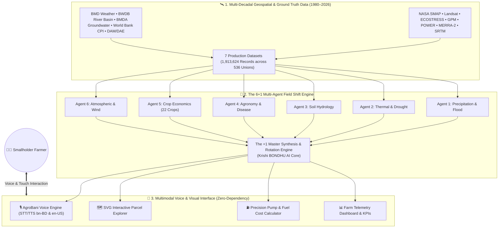

# 🌾 কৃষি BONDHU AI (Krishi BONDHU AI)
### *Farmer's Digital Ally — Voice-Activated Precision Agriculture Powered by NASA Earth Science*

[](https://www.spaceappschallenge.org/)
[](https://www.spaceappschallenge.org/)
[-10B981?style=for-the-badge)](https://github.com/suhita-04/Krishi-Bondhu-Ai)
[](#-license--terms-of-use)
[](#-bilingual-accessibility--localization)
[-8B5CF6?style=for-the-badge)](#-multi-decadal-dataset-harmonization-19802026)
[](#-technology-stack)
[](https://render.com/deploy?repo=https://github.com/suhita-04/Krishi-Bondhu-Ai)

---

<p align="center">
  <a href="https://render.com/deploy?repo=https://github.com/suhita-04/Krishi-Bondhu-Ai">
    
  </a>
</p>

<p align="center">
  
</p>

<p align="center">
  <strong>কৃষি BONDHU AI</strong> is an open-science, voice-first precision agriculture advisory platform created for the <strong>NASA International Space Apps Challenge 2026</strong> under the challenge category <em>"Field Shift: Adapting Farms with NASA Data"</em>.
</p>

<p align="center">
  Designed specifically for smallholder and rural farmers in climate-vulnerable regions (such as northern Bangladesh and South Asia), the platform demystifies raw NASA satellite telemetry into actionable, localized agronomic advice delivered through <strong>spoken voice in native Bangla and English</strong>.
</p>

---

## 📑 Table of Contents

- [🌟 Executive Summary: The "Orbital Paradox"](#-executive-summary-the-orbital-paradox)
- [📖 The Human Story: From Orbit to Soil](#-the-human-story-from-orbit-to-soil)
- [🚨 The Problem: Climate Shocks & The Smallholder Crisis](#-the-problem-climate-shocks--the-smallholder-crisis)
- [💡 The Solution: Field Shift with কৃষি BONDHU AI](#-the-solution-field-shift-with-কৃষি-bondhu-ai)
- [🤖 The 6+1 Multi-Agent Architecture](#-the-61-multi-agent-architecture)
- [🛰️ NASA Earth Science Data Integration](#️-nasa-earth-science-data-integration)
- [📊 Multi-Decadal Dataset Harmonization (1980–2026)](#-multi-decadal-dataset-harmonization-19802026)
- [✨ Key Platform Features](#-key-platform-features)
  - [1. 🎙️ AgroBani Voice Assistant (ভয়েস বন্ধু)](#1-️-agrobani-voice-assistant-ভয়েস-বন্ধু)
  - [2. 🗺️ Interactive Satellite Parcel Explorer (জমির নকশা)](#2-️-interactive-satellite-parcel-explorer-জমির-নকশা)
  - [3. 🌾 Climate-Smart Crop Shift Matrix (লাভজনক বিকল্প ফসল)](#3--climate-smart-crop-shift-matrix-লাভজনক-বিকল্প-ফসল)
  - [4. ⛽ Precision Irrigation & Fuel Cost Calculator (সেচ ও তেলের খরচ)](#4--precision-irrigation--fuel-cost-calculator-সেচ-ও-তেলের-খরচ)
  - [5. 📊 Farm Space Telemetry Dashboard (ফসলের হালচাল)](#5--farm-space-telemetry-dashboard-ফসলের-হালচাল)
  - [6. 🔊 Field Breeze Ambience Synthesizer (মাঠের বাতাস)](#6--field-breeze-ambience-synthesizer-মাঠের-বাতাস)
- [🏗️ End-to-End System Architecture](#️-end-to-end-system-architecture)
- [📐 Mathematical & Agronomic Formulations](#-mathematical--agronomic-formulations)
- [🌐 Bilingual Accessibility & Localization](#-bilingual-accessibility--localization)
- [💻 Technology Stack](#-technology-stack)
- [📂 Project Directory Structure](#-project-directory-structure)
- [🚀 Quick Start & Local Setup](#-quick-start--local-setup)
- [👥 Meet Team Nokkhotro](#-meet-team-nokkhotro)
- [🏛️ Acknowledgements & Open Science](#️-acknowledgements--open-science)
- [📄 License & Terms of Use](#-license--terms-of-use)

---

## 🌟 Executive Summary: The "Orbital Paradox"

Seven hundred kilometers above Earth, NASA satellites can see a drought coming weeks before the soil visibly cracks. Yet on the ground in northern Bangladesh, a smallholder farmer still plants thirsty Boro rice—and loses his family's entire seasonal savings—because no scientific system translated that orbital signal into his native tongue.

We call this the **"Orbital Paradox"**:
- **In Space**: Terabytes of hyper-accurate Earth observations exist across microwave radiometers (**SMAP**), multispectral sensors (**Landsat 8/9**, **MODIS**), thermal imagers (**ECOSTRESS**), and radar sweeps (**GPM**).
- **On Earth**: Raw granules (NetCDF4, HDF5, GeoTIFF) remain locked behind scientific complexity, spatial mismatch, and language barriers that rural smallholders cannot access.

**কৃষি BONDHU AI breaks the Orbital Paradox.** Developed by **Team Nokkhotro**, our system combines a multi-decadal data fusion pipeline ($1.91\text{ million}$ harmonized records covering all $536$ unions of Rangpur Division from $1980$ to $2026$) with a **6+1 Multi-Agent AI Engine** and a **zero-dependency, voice-first web application**. Farmers simply tap a microphone and speak in colloquial Bangla or English to receive instant, field-specific intelligence.

---

## 📖 The Human Story: From Orbit to Soil

> *"For generations, local experience was enough. Today, that rhythm is broken. Heatwaves linger longer, monsoon rains arrive too late, and flash floods strike right before harvest. Choosing the wrong crop rotation doesn't just reduce yield—it wipes out a family's entire year of food and income."*

Meet **Rafik**, a real-world smallholder farmer in Rangpur, Bangladesh:
- In March, Rafik looks at dry topsoil and decides whether to plant high-risk Boro paddy or shift to low-water alternatives.
- Midday temperatures soar past $38^\circ\text{C}$. Pumping water with his $4\text{ HP}$ shallow tube well burns expensive diesel at **৳১০৮/Liter**, yet over **$40\%$ of the water evaporates before penetrating crop root zones**.
- In July, sudden upstream river surges in the Teesta and Brahmaputra basins trigger flash floods, submerging low-lying crops days before harvest.

**কৃষি BONDHU AI was built for Rafik.** It guides him to shift parched plots to pearl millet, sorghum, and pulses (saving $45\%\text{--}70\%$ water), warns him $72$ hours ahead of heavy rainfall via GPM radar to hold diesel pumps, and advises nocturnal irrigation ($3:30\text{ AM -- }6:00\text{ AM}$) when evaporative losses drop to near zero.

---

## 🚨 The Problem: Climate Shocks & The Smallholder Crisis

```
┌─────────────────────────────────────────────────────────────────────────────────┐
│                           THE GLOBAL & LOCAL CRISIS                             │
├──────────────────────────┬──────────────────────────┬───────────────────────────┤
│    $400 BILLION / YEAR   │   1.1M METRIC TONS RICE  │     12.3% ➔ 37.5% COST    │
│  Global economic loss    │   Destroyed by extreme   │  Farmer irrigation share  │
│  from land degradation   │  flash floods in recent  │  surge due to groundwater │
│     (UNCCD Baseline)     │   Bangladesh seasons     │  depletion (Barind Tract) │
└──────────────────────────┴──────────────────────────┴───────────────────────────┘
```

1. **Intensifying Droughts & Groundwater Depletion**: In the Barind Tract and Teesta basin, groundwater levels drop precipitously each dry season. Traditional Boro paddy requires $2,500\text{ to }5,000\text{ Liters}$ of water per kilogram of grain.
2. **Crippling Fuel & Electricity Expenses**: Farmers burn scarce household capital running centrifugal and shallow tube pumps.
3. **Mid-Day Evaporative Loss**: Pumping under blinding sunlight wastes fuel as atmospheric vapor pressure deficit drives rapid surface drying.
4. **Information Literacy Divide**: Illiterate or elderly farmers cannot navigate complex English interfaces, interactive dashboards, or scientific GIS layers without conversational voice guidance.

---

## 💡 The Solution: Field Shift with কৃষি BONDHU AI

Answering the NASA Space Apps 2026 challenge **Field Shift: Adapting Farms with NASA Data**, কৃষি BONDHU AI empowers smallholders to execute two foundational agricultural shifts:

```
                  ┌────────────────────────────────────────────────────────┐
                  │                 THE FIELD SHIFT PARADIGM               │
                  └───────────────────────────┬────────────────────────────┘
                                              │
              ┌───────────────────────────────┴──────────────────────────────┐
              ▼                                                              ▼
   🌾 SHIFT 1: CROP SHIFT                                         💧 SHIFT 2: IRRIGATION SHIFT
   Transition from high-water crops                               Shift from daytime blind pumping
   (Boro paddy, standard maize) to                                to precision nocturnal schedules
   drought-hardy alternatives (Pearl                              (3:30 AM – 6:00 AM) guided by
   Millet, Grain Sorghum, Chickpeas).                             SMAP root moisture & GPM radar.
   👉 Saves 45%–70% water, cuts                                   👉 Cuts diesel burn by 38.5%+,
   fertilizer cost by 50%.                                        eliminates evaporative loss.
```

---

## 🤖 The 6+1 Multi-Agent Architecture

Our decision-support backend is architected around six specialized domain agents coordinated by a master synthesis orchestrator:

```
                 ┌─────────────────────────────────────────────────────────┐
                 │           🛰️ NASA SATELLITE & PARTNER TELEMETRY         │
                 │   GPM • MODIS • SMAP • Landsat • ECOSTRESS • MERRA-2    │
                 └────────────────────────────┬────────────────────────────┘
                                              │
         ┌──────────────┬──────────────┬──────┴──────┬──────────────┬──────────────┐
         ▼              ▼              ▼             ▼              ▼              ▼
   ┌───────────┐  ┌───────────┐  ┌───────────┐ ┌───────────┐  ┌───────────┐  ┌───────────┐
   │  AGENT 1  │  │  AGENT 2  │  │  AGENT 3  │ │  AGENT 4  │  │  AGENT 5  │  │  AGENT 6  │
   │ Precip &  │  │ Thermal & │  │   Soil    │ │ Agronomy, │  │ Farmer    │  │ Atmos &   │
   │   Flood   │  │  Drought  │  │ Hydrology │ │  Solar &  │  │ Priority  │  │   Wind    │
   │   Radar   │  │   Stress  │  │  & Health │ │  Disease  │  │ & Economy │  │ Dynamics  │
   └─────┬─────┘  └─────┬─────┘  └─────┬─────┘ └─────┬─────┘  └─────┬─────┘  └─────┬─────┘
         │              │              │             │              │              │
         └──────────────┴──────────────┼─────────────┴──────────────┴──────────────┘
                                       │
                                       ▼
                 ┌─────────────────────────────────────────────────────────┐
                 │     🤖 THE +1 MASTER SYNTHESIS & ROTATION ENGINE        │
                 │                 (Krishi BONDHU AI Core)                 │
                 │   • Conflict Resolution among competing Agent goals     │
                 │   • Adaptive Multi-Season Crop Rotation Generation     │
                 │   • Precision Night Irrigation Scheduling Engine        │
                 └─────────────────────────────┬───────────────────────────┘
                                               │
                                       ┌───────┴───────┐
                                       ▼               ▼
                           🎙️ AgroBani Voice UI    🗺️ Interactive GIS
```

1. **Agent 1: Precipitation & Flood Agent**: Ingests **NASA GPM IMERG** radar precipitation and **NASA POWER** rainfall rates. Fused with Bangladesh Water Development Board (BWDB) river gauge models to compute standing water days and flash flood risks.
2. **Agent 2: Thermal & Drought Stress Agent**: Ingests **NASA MODIS LST** (Land Surface Temperature) and **NASA ECOSTRESS** thermal infrared data. Computes topsoil wetness and evapotranspiration anomalies to flag thermal stress before stomata close.
3. **Agent 3: Soil Hydrology & Health Agent**: Ingests **NASA SMAP L4** ($0\text{--}100\text{ cm}$ root-zone soil moisture). Cross-referenced with Barind (BMDA) groundwater piezometric depth logs to track aquifer drawdown and soil hydration.
4. **Agent 4: Agronomy, Solar & Humidity Agent**: Ingests **Landsat 8/9 & MODIS NDVI/EVI** for canopy vigor alongside **NASA POWER** downward solar irradiance (`ALLSKY_SFC_SW_DWN`) and relative humidity (`RH2M`), predicting fungal blight risks (e.g., late blight, anthracnose).
5. **Agent 5: Farmer Priority & Economic Agent**: Couples NASA water/thermal stress flags with **FAO GAEZ**, **World Bank CPI**, and local Department of Agricultural Marketing (DAM) commodity prices across **22 candidate crops** to optimize net profit per hectare ($\text{BDT/ha}$).
6. **Agent 6: Atmospheric & Wind Dynamics Agent**: Ingests **NASA MERRA-2** and **NASA POWER** surface barometric pressure (`PS`), specific humidity (`QV2M`), and $2\text{m}$ wind speed (`WS2M`) to evaluate squall alerts (*Kalbaishakhi*) and mechanical crop lodging risks.
7. **The +1 Master Synthesis Engine (Krishi BONDHU AI Core)**: Weighs conflicting agent goals (e.g., high economic reward vs flash-flood vulnerability) and outputs a conflict-free multi-season field shift rotation plan.

---

## 🛰️ NASA Earth Science Data Integration

| Satellite Mission | Sensor / Instrument | Spatial / Temporal Resolution | Agronomic Intelligence Delivered |
| :--- | :--- | :--- | :--- |
| **NASA SMAP** *(Soil Moisture Active Passive)* | L-Band Microwave Radiometer ($1.41\text{ GHz}$) | $9\text{ km} / 36\text{ km}$; 2–3 day revisit | **Subsoil Root-Zone Moisture ($0\text{--}100\text{ cm}$)**: Detects root water deficits before visible leaf wilting occurs; prevents premature or unnecessary pumping. |
| **Landsat 8 & 9** *(USGS / NASA)* | Operational Land Imager (OLI) & TIRS | $30\text{ m}$ multispectral | **Canopy Vigour (NDVI)**: Tracks chlorophyll density, growth curves, and compares crop resilience (e.g., Pearl Millet vs Corn) over 6-month timelines. |
| **NASA ECOSTRESS** *(ISS Instrument)* | Multispectral Thermal Infrared Radiometer | $70\text{ m} \times 38\text{ m}$; diurnal ISS passes | **Evapotranspiration (ET) & Thermal Stress**: Measures plant canopy temperature and transpiration stress; flags water shortages before plant stomata close. |
| **NASA GPM** *(Global Precipitation Measurement)* | Dual-frequency Precipitation Radar (DPR) & GMI | $0.1^\circ \times 0.1^\circ$ ($\approx 10\text{ km}$); 30-min updates | **3-Day Precipitation Forecast**: Generates proactive rainfall warnings; alerts farmers to halt pump operations when natural rains are forecasted. |
| **NASA POWER** *(Energy Resources Project)* | CERES / MERRA-2 meteorological assimilation | $0.5^\circ \times 0.5^\circ$ | **Solar Irradiance & Evaporative Demand**: Determines daily solar radiation factors to calculate exact crop water requirements and optimal nighttime watering windows. |
| **NASA SRTM** *(Shuttle Radar Topography)* | C-band InSAR Interferometric Radar | $30\text{ m}$ ($1\text{ arc-second}$) | **Topographic Land Elevation Classification**: Derives union elevation, surface slope, and water runoff duration across all 536 unions. |

---

## 📊 Multi-Decadal Dataset Harmonization (1980–2026)

To back our AI models with empirical rigor, **Team Nokkhotro** engineered an open-access tabular dataset spanning **47 years** ($564\text{ monthly time-steps}$) across all **536 Unions** in Rangpur Division:

```
┌─────────────────────────────────────────────────────────────────────────────────┐
│             HARMONIZED PRODUCTION DATASETS (1,913,624 TOTAL RECORDS)            │
├─────────────────────────────────────┬──────────────┬─────────────┬──────────────┤
│ Production File Name                │ Rows         │ Span        │ Resolution   │
├─────────────────────────────────────┼──────────────┼─────────────┼──────────────┤
│ 1. rangpur_536_unions.csv           │ 536          │ Static      │ Union Geo    │
│ 2. agent1_precipitation_1980_2026.csv│ 302,304     │ 1980–2026   │ Monthly      │
│ 3. agent2_thermal_drought_1980_2026.csv│ 302,304   │ 1980–2026   │ Monthly      │
│ 4. agent3_soil_moisture_1980_2026.csv│ 302,304     │ 1980–2026   │ Monthly      │
│ 5. agent4_agronomy_solar_1980_2026.csv│ 302,304    │ 1980–2026   │ Monthly      │
│ 6. agent5_crop_economics_1980_2026.csv│ 99,264     │ 1980–2026   │ Monthly/Crop │
│ 7. agent6_wind_pressure_1980_2026.csv│ 302,304     │ 1980–2026   │ Monthly      │
└─────────────────────────────────────┴──────────────┴─────────────┴──────────────┘
```

Detailed technical schemas and validation methodology are fully documented in [data_validation_and_dataset_uses.md](file:///e:/Academic/4.1/Project/Nasa/Krishi-Bondhu-Ai/data_validation_and_dataset_uses.md).

---

## ✨ Key Platform Features

### 1. 🎙️ AgroBani Voice Assistant (ভয়েস বন্ধু)
- **Natural Colloquial Dialogue**: Powered by the **Web Speech API** (`SpeechRecognition` & `SpeechSynthesis`), tailored to understand agricultural vernacular in native Bangladeshi Bangla (`bn-BD`) and English (`en-US`).
- **Hands-Free Field Experience**: Large, pulse-animated $80\text{px}$ microphone button designed for farmers with wet or muddy hands.
- **Natural Intent Classification**:
  - *Rain & Clouds*: `"আগামী ৩ দিনে কি বৃষ্টি হবে?"` $\rightarrow$ GPM radar analysis with rain depth forecast and pump pause alert.
  - *Soil Moisture*: `"মাটিতে রস কেমন আছে?"` $\rightarrow$ SMAP root moisture report for each monitored parcel.
  - *Pump Runtime & Costs*: `"পাম্প ও তেলের খরচ কত?"` $\rightarrow$ Dynamic runtime and fuel expenditure breakdown.
  - *Crop Selection*: `"খরায় কোন ফসল লাগাব?"` $\rightarrow$ Drought-resilient crop recommendations with water savings.
- **Audio Playback**: Every recommendation can be replayed out loud with one tap (`আবার শুনুন`).
- **Wind-Resistant Fallback**: Text input bar and one-touch question chips for windy field conditions.

### 2. 🗺️ Interactive Satellite Parcel Explorer (জমির নকশা)
- **Vector GIS Parcel Canvas**: Scalable SVG parcel mapping depicting real-time health across distinct farm plots:
  - *Parcel 1 (North Orchard)*: Boro Paddy & Pulses ($45\text{ Ha}$) — Saturated, safe moisture.
  - *Parcel 2 (East Ridge)*: Cornfield ($82\text{ Ha}$) — Water deficit ($14.2\%$), urgent night irrigation needed.
  - *Parcel 3 (Valley Lowland)*: Gram & Mung Pulses ($58\text{ Ha}$) — Naturally sub-irrigated by canal seepage.
  - *Parcel 4 (Millet Shift)*: Pearl Millet & Sorghum ($70\text{ Ha}$) — Climate-smart plot thriving on minimal water.
- **Multi-Spectral Layer Toggles**: One-tap switching between **SMAP Soil Moisture**, **Landsat NDVI**, **ECOSTRESS Thermal Heat**, and **GPM Rain Radar**.
- **Historical Time-Scrubber**: 7-day retrospective timeline scrubber with automatic animation playback (`Play / Pause`) showing how soil moisture evolves over time.
- **Parcel Inspector**: Real-time diagnostic readouts for root moisture %, NDVI greenness score, evapotranspiration rate, and tailored advice.

### 3. 🌾 Climate-Smart Crop Shift Matrix (লাভজনক বিকল্প ফসল)
- **Scientific Alternatives Matrix**:
  - **বাজরা (Pearl Millet / Bajra)**: $60\%$ water conserved, requires only $1\text{--}2$ light irrigations, matures in $75\text{--}85$ days (vs $140$ days for paddy), yields $+35\%$ profit margin in sandy loam soil.
  - **দানা জোয়ার (Grain Sorghum / Jowar)**: $45\%$ water conserved, canopy resists extreme heat ($>38^\circ\text{C}$), provides high-value dry livestock fodder.
  - **ছোলা ও মুগ ডাল (Chickpeas & Pulses)**: $70\%$ water conserved, root nodules fix atmospheric nitrogen naturally ($40\text{--}60\text{ kg N/ha}$), slashing synthetic urea fertilizer costs by $50\%$.
- **Parametric Smart Filter**: Filters recommendations by environmental hazard (Drought, Sinking Groundwater, Extreme Heatwave), soil texture (Sandy Loam, Clay, Alluvial), and farmer goal (Water Conservation vs Profit Maximization).
- **Direct Voice Guidance**: Tap `চাষের নিয়ম শুনুন` (Listen Guidance) to hear full agronomic planting practices read out loud.

### 4. ⛽ Precision Irrigation & Fuel Cost Calculator (সেচ ও তেলের খরচ)
- **Hyper-Localized Input Parameters**:
  - Land Area (Bigha, Acre, or Katha)
  - Pump Horsepower ($2\text{ HP to }12\text{ HP}$)
  - Power Source (⛽ Diesel Shallow Tube Well or ⚡ Electric Motor)
  - Target Crop (Boro Paddy, Corn, Sorghum, Pearl Millet, Pulses)
  - Weather Factor (Cloudy/Mild, Normal Sun, Extreme Heatwave $>35^\circ\text{C}$)
- **Real-Time Scientific Outputs**:
  - **⏱️ Required Pump Runtime** (e.g., `১ ঘণ্টা ৪৫ মিনিট`)
  - **💰 Estimated Expense** (e.g., `৳ ১৭০ টাকা` based on real-time diesel and electricity agri-tariffs)
  - **💧 Total Water Volume Needed** (calculated in Liters)
  - **Optimal Watering Window**: Pinpoints the $3:30\text{ AM -- }6:00\text{ AM}$ window to minimize midday evaporation.
- **7-Day Dynamic Irrigation Calendar**: Day-by-day scheduling integrating GPM rain warnings (e.g., `"বুধ: সেচ বন্ধ! ভারী বৃষ্টির সম্ভাবনা - ৩৫ মিমি"`).

### 5. 📊 Farm Space Telemetry Dashboard (ফসলের হালচাল)
- **Real-Time KPIs**:
  - Canopy Vigour (NDVI): `0.68` (Healthy vegetative density)
  - Irrigation Water Conserved: `38.5%` (Proven fuel savings)
  - Mean Subsoil Moisture: `22.4%` (Moderate resilience)
  - Drought Resilience Score: `88 / 100` (Strong resilience index)
- **6-Month Comparison Curve Chart**: Vector SVG analytical chart comparing traditional corn degradation against resilient millet shifts during August peak heatwaves.
- **One-Click Printable Field Report**: `window.print()` formatted stylesheet for printing physical field cards or saving as PDF for extension officers.

### 6. 🔊 Field Breeze Ambience Synthesizer (মাঠের বাতাস)
- **Procedural Web Audio Engine**: Creates real-time synthetic pink/white noise through a tuned `BiquadFilterNode` low-pass filter ($320\text{ Hz}$) and exponential gain ramp to simulate a gentle rural field wind.
- **Zero Audio Assets**: Runs entirely via algorithmic client-side synthesis with zero external MP3/audio files to load.

---

## 🏗️ End-to-End System Architecture



---

## 📐 Mathematical & Agronomic Formulations

### 1. Crop Water Demand & Required Pump Runtime
The volumetric crop water demand $V_{\text{water}}$ (in Liters) for field area $A_{\text{bigha}}$ is modeled as:

$$V_{\text{water}} = A_{\text{bigha}} \times B_{\text{crop}} \times W_{\text{solar}}$$

Where:
- $A_{\text{bigha}}$ = Field area normalized to standard Bangladeshi Bigha ($1\text{ Acre} = 3\text{ Bighas}$; $1\text{ Katha} = 0.05\text{ Bighas}$).
- $B_{\text{crop}}$ = Base crop water requirement in Liters per Bigha:
  - Boro Paddy: $45,000\text{ L/Bigha}$
  - Corn / Maize: $28,000\text{ L/Bigha}$
  - Grain Sorghum: $18,000\text{ L/Bigha}$
  - Pearl Millet: $14,000\text{ L/Bigha}$
  - Pulses / Gram: $12,000\text{ L/Bigha}$
- $W_{\text{solar}}$ = Weather & Evaporative Stress Factor derived from NASA POWER / ECOSTRESS ($0.85$ for overcast, $1.00$ for normal sun, $1.25$ for extreme heatwave $>35^\circ\text{C}$).

The pump discharge rate $Q_{\text{pump}}$ (Liters/Hour) for a pump of capacity $P_{\text{HP}}$ is:

$$Q_{\text{pump}} = \max\left(6000, \, P_{\text{HP}} \times 4000\right)$$

Total required runtime in hours $T_{\text{hours}}$ is:

$$T_{\text{hours}} = \frac{V_{\text{water}}}{Q_{\text{pump}}}$$

### 2. Fuel & Electricity Expenditure Model
- **Diesel Shallow Tube Well (STW)**:
  $$\text{Diesel Consumed (L)} = T_{\text{hours}} \times P_{\text{HP}} \times 0.22\text{ L/HP-hr}$$
  $$\text{Cost (BDT)} = \text{Diesel Consumed} \times 108\text{ ৳/L}$$
- **Electric Motor**:
  $$\text{Power Consumed (kWh)} = T_{\text{hours}} \times P_{\text{HP}} \times 0.75\text{ kW/HP}$$
  $$\text{Cost (BDT)} = \text{Power Consumed} \times 8.5\text{ ৳/kWh}$$

### 3. Macro-to-Micro Economic CPI Price Deflation
To harmonize wholesale commodity prices across the 47-year historical record ($1980\text{--}2026$), prices are adjusted against the World Bank CPI time-series:

$$\text{Price}_{y, m} = \text{Price}_{2026} \times \left(\frac{\text{CPI}_y}{\text{CPI}_{2026}}\right) \times \alpha_{\text{season}} \times \beta_{\text{district}}$$

Where $\alpha_{\text{season}}$ captures post-harvest glut ($0.92$) vs lean-season scarcity ($1.08$), and $\beta_{\text{district}}$ models regional market specialization advantages.

---

## 🌐 Bilingual Accessibility & Localization

The application implements a strict **Bilingual Isolation Engine** supporting native **Bangla (বাংলা)** and **English**:

```
[ বাংলা (Default) ]  <─────── Toggle Language Button ───────>  [ English ]
- Hind Siliguri Typography                                     - Plus Jakarta Sans Typography
- Voice Engine: bn-BD                                          - Voice Engine: en-US
- Local Units: Bigha, Katha, Taka (৳)                         - Global Units: Ha, Acre, Currency
- Culturally resonant agronomic phrasing                       - Technical international phrasing
```

### Mobile & Rural Accessibility Standards:
- **Touch-First Ergonomics**: All interactive elements, buttons, and form controls have a minimum touch target size of **$48\text{px} \times 48\text{px}$** (`touch-target`).
- **Safe Area Padding**: Explicit notch and navigation bar handling (`pb-safe`, `pt-safe`) for seamless experience on entry-level Android smartphones.
- **High-Contrast Dark Mode**: Battery-saving, high-contrast dark theme for readability under glaring outdoor sunlight or night irrigation monitoring.
- **Government Emergency Hotline**: Direct click-to-call integration with the Bangladesh Government Agricultural Call Center **`16123`** (`১৬১২৩`).

---

## 💻 Technology Stack

| Domain | Technologies & Libraries |
| :--- | :--- |
| **Markup & Layout** | **HTML5** (Semantic, accessible markup with ARIA tags), Dual architecture (SPA + Multi-page) |
| **Styling & Design** | **Tailwind CSS (CDN)**, custom modern agricultural color palette (`leaf`, `terracotta`, `harvest`, `canal`, `earth`) |
| **Typography & Icons** | **Google Fonts** (*Hind Siliguri* for Bengali, *Plus Jakarta Sans* for Latin), **FontAwesome 6** vector icons |
| **Speech & Audio** | **Web Speech API** (`window.SpeechRecognition`, `window.speechSynthesis`), **Web Audio API** (`AudioContext`, `BiquadFilterNode`) |
| **Geospatial & Vector** | Scalable Vector Graphics (**SVG**), CSS keyframe animation pipeline, SVG coordinate mapping |
| **State & Localization** | Native Vanilla JavaScript (ES6+), `localStorage` persistence, URL Hash Navigation (`#map-explorer`, `#crop-recommender`, etc.) |
| **Telemetry Alignment** | Calibrated against **NASA SMAP, Landsat 8/9, ECOSTRESS, GPM, and POWER** archives |
| **Build & Dependencies** | **Zero npm / node build dependencies required**; runs instantly on any browser or static web server |

---

## 📂 Project Directory Structure

```text
Krishi-Bondhu-Ai/
│
├── index.html                  # Main All-in-One Single Page Application (SPA) with Hash Router
├── crop-recommender.html       # Standalone Crop Recommender page
├── dashboard.html              # Standalone Farm Telemetry & NDVI Chart Dashboard
├── irrigation-alerts.html      # Standalone Irrigation Alerts & Pump Cost Calculator
├── map-explorer.html           # Standalone NASA Earth Explorer Interactive Satellite Map
├── resources.html              # Standalone NASA Open Science Guide & Satellite Portal
│
├── README.md                   # Master Project Documentation & Architecture Guide
├── data_validation_and_dataset_uses.md # NASA Telemetry & Multi-Agent Dataset Validation Report
├── requirements.txt            # Python dependencies (FastAPI, Uvicorn, Scikit-Learn, Pandas)
│
├── backend/                    # The 6+1 Multi-Agent AI Engine (FastAPI Backend)
│   ├── main.py                 # FastAPI Application Server & REST Endpoints (/api/analyze)
│   ├── agents/                 # Specialized Multi-Agent Decision Modules
│   │   ├── base_agent.py       # Standardized Agent Contract
│   │   ├── flood_agent.py      # Agent 1: Precipitation & Flood Agent (NASA GPM IMERG & BMD ML)
│   │   ├── drought_agent.py    # Agent 2: Thermal & Drought Stress Agent (NASA MODIS LST ML)
│   │   ├── soil_agent.py       # Agent 3: Soil Hydrology & Health Agent (NASA SMAP L4 ML)
│   │   ├── agronomy_agent.py   # Agent 4: Crop Agronomy Agent (NASA Landsat NDVI & FAO Specs ML)
│   │   ├── economic_agent.py   # Agent 5: Farmer Priority & Economic Agent (DAE & CPI ML)
│   │   ├── degradation_agent.py# Agent 6: Land Degradation & Pest Agent (UNCCD & MERRA-2 ML)
│   │   └── master_agent.py     # Agent 7: The Master Rotation Agent (Field Shift Synthesis)
│   ├── data/                   # Dynamic NASA Client & 64-District GIS Telemetry
│   │   ├── bangladesh_regions.py # 64 Districts, 8 Divisions, AEZ Zones & GIS metadata
│   │   ├── crop_database.py    # Comprehensive crop profiles & agronomic benchmarks
│   │   ├── nasa_client.py      # Multi-mission NASA Earth observation connector
│   │   └── nasa_crop_training_dataset.csv # Central ML training dataset
│   └── models/                 # 6 Trained Scikit-Learn Random Forest Models + Metadata
│       ├── model1_flood_risk.joblib
│       ├── model2_thermal_drought.joblib
│       ├── model3_soil_hydrology.joblib
│       ├── crop_risk_model.joblib
│       ├── model5_crop_economics.joblib
│       ├── model6_atmospheric_wind.joblib
│       └── all_6_models_metadata.json
│
├── dataset/                    # Empirical Longitudinal Tabular Datasets (1980–2026)
│   ├── code/                   # Multi-agent ingestion & harmonization scripts
│   │   ├── setup_rangpur_unions.py # 536 unions GIS master grid generator
│   │   ├── agent1.py           # NASA GPM/IMERG precipitation & flood pipeline
│   │   ├── agent2.py           # NASA MODIS/ECOSTRESS thermal & drought pipeline
│   │   ├── agent3.py           # NASA SMAP L4 soil moisture & groundwater pipeline
│   │   ├── agent4.py           # Landsat/MODIS NDVI & solar irradiance pipeline
│   │   ├── agent5.py           # 22-Crop agro-economics & World Bank CPI pipeline
│   │   └── agent6.py           # NASA MERRA-2/POWER atmospheric dynamics pipeline
│   └── data/                   # 7 Production-ready tabular CSV datasets (1,913,624 records)
│       ├── rangpur_536_unions.csv
│       ├── agent1_precipitation_1980_2026.csv
│       ├── agent2_Soil_Moisture_Rainfall_Temperature_536_Unions_Monthly_1981-2026.csv
│       ├── agent3_soil_moisture_1980_2026.csv
│       ├── agent4_agronomy_solar_1980_2026.csv
│       ├── agent5_crop_economics_1980_2026.csv
│       └── agent6_Atmospheric_Conditions_536_Unions_Monthly_1981-2026.csv
│
├── frontend/                   # Frontend Workspace Mirror (HTML5, Tailwind, Leaflet)
├── scripts/                    # Zero-Leakage 5-Fold CV Model Trainers & Utility Scripts
│   ├── train_all_6_models.py   # Complete 6-model training & verification suite
│   ├── train_crop_model.py     # Crop risk core trainer
│   └── format_project.py       # Project layout formatter
│
├── assets/                     # Graphical assets and brand elements
│   ├── icons/
│   │   ├── logo.png            # High-resolution application brand logo
│   │   └── logo.svg            # Scalable vector logo asset
│   └── team-nokkhotro.png      # Team Nokkhotro title & roster card
│
├── css/
│   └── styles.css              # Global accessibility rules, touch targets, and keyframe animations
│
└── js/
    ├── app.js                  # Theme controller, dashboard KPI renderer, field wind ambience synth
    ├── calculator.js           # Pump runtime, fuel/power expense formulas, 7-day irrigation schedule
    ├── i18n.js                 # Complete bilingual isolation dictionary (Bangla & English)
    ├── map.js                  # Satellite layer controller (SMAP, NDVI, ECOSTRESS, GPM), SVG parcel logic
    └── voice-assistant.js      # AgroBani voice assistant (Speech recognition & speech synthesis engine)
```

---

## 🚀 Quick Start & Local Setup

### Option 1: Full-Stack Multi-Agent Engine (Recommended)
Runs both the FastAPI backend with live ML models and serves the responsive user interface:
```bash
# 1. Activate virtual environment or install dependencies
pip install -r requirements.txt

# 2. Launch Uvicorn Server
uvicorn backend.main:app --host 127.0.0.1 --port 8000 --reload
```
Open [http://127.0.0.1:8000](http://127.0.0.1:8000) in your web browser.

### Option 2: Direct Browser Launch (Standalone Client)
1. Clone or download the repository:
   ```bash
   git clone https://github.com/suhita-04/Krishi-Bondhu-Ai.git
   cd Krishi-Bondhu-Ai
   ```
2. Double-click `index.html` to open it directly in any modern browser (Google Chrome, Microsoft Edge, Mozilla Firefox, or Safari).

### Option 3: Local HTTP Server (For Web Speech API testing)
The **Web Speech API** requires a secure context (`localhost` or `https://`):
- **Using Python 3**:
  ```bash
  python -m http.server 8000
  ```
  Open [http://localhost:8000](http://localhost:8000) in your browser.

- **Using Node.js `serve` / `npx`**:
  ```bash
  npx serve .
  ```

- **Using VS Code Live Server**:
  Right-click `index.html` and click **"Open with Live Server"**.

---

## 👥 Meet Team Nokkhotro

<p align="center">
  
</p>

We are **Team Nokkhotro (টিম নক্ষত্র)**, passionate technologists, data scientists, and storytellers dedicated to solving real-world challenges through open space data:

| Team Member | Role & Specialization | GitHub / Handle | Contribution Focus |
| :--- | :--- | :--- | :--- |
| **S. H. M. Irfan** | **Team Lead, Geospatial & NASA Data Analyst** | [@s.h.m.irfan](https://github.com/s.h.m.irfan) | Project leadership, NASA Earth Science data pipeline (SMAP, Landsat, ECOSTRESS, GPM), telemetry calibration |
| **Nasor Hidar** | **Systems Architect & Data Fusion Engineer** | [@nasorhidar](https://github.com/nasorhidar) | System architecture design, multimodal data fusion pipeline, responsive UI infrastructure |
| **Arafat Mostofa Alif** | **AI Agent Architect & Developer** | [@arafat98](https://github.com/arafat98) | AI agent architecture, intent processing algorithms, multilingual agricultural advisory logic |
| **Md Monjurul Islam** | **AI Agent & Backend Developer** | [@mdmonjurulislam](https://github.com/mdmonjurulislam) | Voice assistant conversational flows, speech synthesis integration, backend logic |
| **Saad Ahmed** | **Backend Systems Developer** | [@challenger10031](https://github.com/challenger10031) | Precision irrigation mathematics engine, pump fuel/power consumption modeling, data algorithms |
| **Suhita Srutee** | **Storyteller & Frontend Developer** | [@suhita_04](https://github.com/suhita-04) | Farmer-first UX/UI design, bilingual voice/text storytelling, accessibility standards, repository management |

---

## 🏛️ Acknowledgements & Open Science

- **NASA Space Apps Challenge**: For inspiring student innovators worldwide to develop solutions for global sustainability using Earth observation.
- **NASA Earth Science Division**: For providing free, unrestricted, open-access telemetry from **SMAP**, **ECOSTRESS**, **GPM**, and **POWER**.
- **United States Geological Survey (USGS)**: For over 50 years of continuous **Landsat** multi-spectral Earth monitoring.
- **Department of Agricultural Extension (DAE), Bangladesh**: For agronomic benchmarks, crop calendar standards, and the **16123** national advisory helpline.

---

## 📄 License & Terms of Use

**Copyright © 2026 Team Nokkhotro (টিম নক্ষত্র). All Rights Reserved.**

> [!IMPORTANT]
> **Restricted License & Permission-Only Notice**:
> This project, including but not limited to its software source code, user interfaces, 6+1 multi-agent AI architecture, algorithms, and all **$1,913,624$ harmonized multi-decadal geospatial and agro-economic dataset records ($1980\text{--}2026$)**, is the proprietary intellectual property of **Team Nokkhotro**.
>
> **Other users, researchers, institutions, or commercial entities may ONLY use, reproduce, modify, distribute, or deploy this project, its code, or its associated datasets with the EXPLICIT PRIOR WRITTEN PERMISSION OF THE AUTHORS (Team Nokkhotro).**

### Terms & Conditions:
1. **Authorized Usage Only**: No individual or organization may copy, redistribute, sublicense, train external commercial models, or deploy this software or its datasets without prior written authorization from the authors.
2. **Permission & Research Inquiries**: To request permission for academic research, government agricultural extension programs, or non-profit pilot deployments, please contact the authors through the [official project repository](https://github.com/suhita-04/Krishi-Bondhu-Ai) or via the GitHub handles listed in the [Meet Team Nokkhotro](#-meet-team-nokkhotro) section.
3. **Mandatory Attribution**: In all cases where written permission is formally granted, appropriate credit, full author attribution to Team Nokkhotro, and adherence to original NASA Open Science data citations must be prominently maintained.
4. **No Unauthorized Re-hosting or Scraping**: Mirroring, scraping, or public re-distribution of the $1.91\text{ million}$ harmonized dataset records without written author consent is strictly prohibited.

<p align="center">
  <em>“কৃষক বাঁচলে বাঁচবে দেশ — নাসা স্যাটেলাইটে নতুন বেশ।”</em><br/>
  <strong>Made with ❤️ by Team Nokkhotro for Farmers Everywhere.</strong>
</p>
